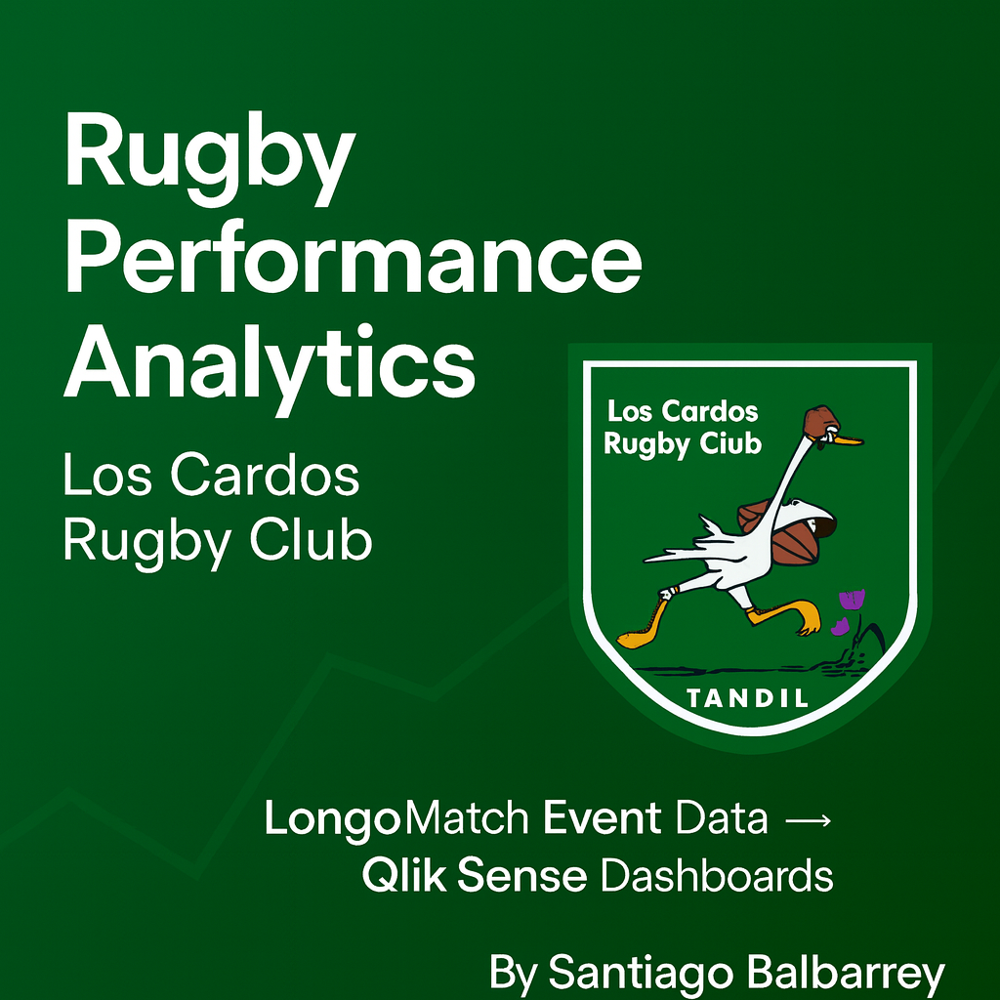

# 🏉 Rugby Performance Analytics – Los Cardos Rugby Club
### LongoMatch Event Data + Qlik Sense Dashboards


     

<p align="center">
  
</p>

## 📌 Overview
This project analyzes match performance for **Los Cardos Rugby Club** using event‑based data exported from **LongoMatch** and processed in **Qlik Sense**.  
The goal is to automate post‑match reporting and provide actionable insights to the coaching staff through interactive dashboards.

---

## 🧱 Tech Stack
- LongoMatch (event tagging & data export)  
- Qlik Sense (ETL, data modeling, dashboards)  
- Excel / CSV (raw data handling)  
- Data modeling: star‑schema‑inspired structure  
- Visualization: KPI dashboards, trend analysis, performance categories  

---

## 📊 Dashboards
- Overview dashboard  
- Attack Performance 
- Set Piece Acquisition (Scrum & Lineout)  
- Set Piece Launches (Scrum & Lineout)  
- Breaks  
- Discipline  

### Overview


### Attack Performance


### Set Piece Acquisition


---

## 🔍 Key Metrics
- Try origin & attacking patterns  
- Break efficiency & outcomes  
- Scrum and lineout success rates  
- Launch effectiveness  
- Penalties by type and phase  
- Turnovers & multiphase play  
- Points scored, conceded & efficiency indicators  

---

## ⚙️ Workflow Summary
1. Export match events from LongoMatch (CSV).  
2. Clean, normalize, and structure the data.  
3. Build a data model in Qlik Sense.  
4. Create dashboards with automated reloads.  
5. Generate post‑match insights for weekly analysis.

---
## 📁 Repository Structure

```
Perfomance-Analyst-Los-Cardos-Rugby-Club/
│
├── scripts/
│   └── qlik/
│       ├── Fact_Partidos.qvs
│       ├── Dim_Fecha.qvs
│       ├── Dim_Rival.qvs
│       ├── Dim_Metrica.qvs
│       └── Global_Variables.qvs
│
├── dashboards/
│   ├── Torneo UNRMDP - Dashboard.png
│   ├── Torneo UNRMDP - Attacking Perfomance.png
│   ├── Torneo UNRMDP - Set Piece Aquisition.png
│   ├── Torneo UNRMDP - Set Piece Launches.png
│   ├── Torneo UNRMDP - Breaks.png
│   ├── Torneo UNRMDP - Discipline.png
│   └── torneo2025video.mp4
│
├── docs/
│   ├── project_overview.md
│   ├── etl_overview.md
│   ├── data_model.md
│   ├── workflow.md
│   └── next_steps.md
│
├── images/
│   └── cover/
│
├── README.md
└── LICENSE
```---

## 🚀 Next Steps
- Full automation of the ETL pipeline  
- Integration with GPS/tracking data  
- Predictive analytics for performance forecasting  
- Additional KPIs for player‑level analysis  

---

## 👤 Author
**Santiago Balbarrey**  
Data Analytics | BI | Sports Analytics


[](https://www.linkedin.com/in/santiagobalbarrey/)

You can reach me on LinkedIn for feedback, collaboration, or project discussions.